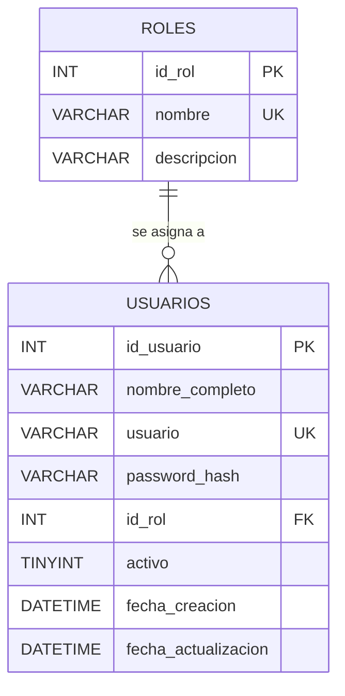

# SDCC-17 — Diseño de la estructura de usuarios y roles

**Proyecto:** Sistema de Control de Comensales — UABJB  
**Historia principal:** SDCC-13 — Gestionar acceso del personal autorizado  
**Subtarea:** SDCC-17 — Diseñar la estructura de usuarios y roles del sistema  
**Responsable:** Camila Arrazola Vargas  
**Estado:** Propuesta de diseño, pendiente de revisión por el equipo y Humberto.

## 1. Objetivo

Definir cómo se almacenarán las cuentas del personal y sus roles en **MySQL**, para que la aplicación PHP pueda autenticar a los trabajadores y restringir las funciones disponibles a cada rol.

Este documento **no implementa todavía** el inicio/cierre de sesión ni la autorización en PHP; esas funcionalidades corresponden a otras subtareas.

## 2. Roles considerados

| Rol técnico | Personal | Responsabilidades previstas |
|---|---|---|
| `admin` | Administración / Bienestar Estudiantil | Administrar cuentas según permisos definidos; registrar y actualizar becarios; generar credenciales QR; consultar reportes. |
| `recepcionista` | Recepción del comedor | Identificar al estudiante y registrar la autorización del servicio. |
| `cocina` | Ventanilla / cocina | Consultar una autorización válida y confirmar la entrega real de la ración. |

**Regla clave:** recepción autoriza; ventanilla confirma la entrega. Son operaciones distintas, que se desarrollarán en el Sprint 2.

Los permisos definitivos deben contrastarse con el documento **SDCC-16 — Requisitos de acceso y permisos**, antes de aprobar este diseño.

## 3. Estructura propuesta de datos

### Tabla `roles`

| Campo | Tipo MySQL | Restricciones | Propósito |
|---|---|---|---|
| `id_rol` | `INT UNSIGNED` | PK, autoincremental | Identificador interno del rol |
| `nombre` | `VARCHAR(30)` | NOT NULL, UNIQUE | Clave técnica: `admin`, `recepcionista`, `cocina` |
| `descripcion` | `VARCHAR(150)` | NULL | Nombre o propósito del rol |

### Tabla `usuarios`

| Campo | Tipo MySQL | Restricciones | Propósito |
|---|---|---|---|
| `id_usuario` | `INT UNSIGNED` | PK, autoincremental | Identificador interno de la cuenta |
| `nombre_completo` | `VARCHAR(150)` | NOT NULL | Nombre del trabajador |
| `usuario` | `VARCHAR(80)` | NOT NULL, UNIQUE | Identificador usado para iniciar sesión |
| `password_hash` | `VARCHAR(255)` | NOT NULL | Hash seguro de la contraseña; nunca texto plano |
| `id_rol` | `INT UNSIGNED` | NOT NULL, FK → `roles.id_rol` | Rol asignado |
| `activo` | `TINYINT(1)` | NOT NULL, DEFAULT 1 | 1 = habilitado; 0 = deshabilitado |
| `fecha_creacion` | `DATETIME` | NOT NULL | Momento de creación |
| `fecha_actualizacion` | `DATETIME` | NOT NULL | Última modificación |

**Cardinalidad:** un rol puede tener muchos usuarios; cada usuario tiene exactamente un rol en esta primera versión.

## 4. Diagrama entidad-relación (Mermaid)

Este diagrama se puede visualizar en GitHub o en VS Code con una extensión compatible con Mermaid. Para Jira, exportar a PNG o PDF después de revisarlo.

## 5. Reglas funcionales y de seguridad

1. Cada trabajador debe disponer de una cuenta individual; no compartir usuarios.
2. El nombre de usuario debe ser único.
3. La contraseña se guardará únicamente como hash generado por `password_hash()` en PHP; se comprobará con `password_verify()`.
4. La aplicación debe rechazar el inicio de sesión de cuentas con `activo = 0`.
5. La autorización de funciones debe validarse **en el servidor PHP**, no solo ocultando botones en la interfaz.
6. Solo usuarios autorizados podrán crear, deshabilitar o cambiar el rol de otras cuentas.
7. El código PHP empleará consultas preparadas (PDO) para interactuar con MySQL.
8. No guardar contraseñas, credenciales reales ni archivos de configuración con secretos en GitHub.
9. El proceso de creación de cuentas deberá definirse en las subtareas de implementación; este diseño no incluye cuentas iniciales ni contraseñas predeterminadas.

## 6. Integración con otras subtareas

| Subtarea | Relación |
|---|---|
| SDCC-16 | Define los requisitos y permisos que esta estructura debe soportar. |
| SDCC-17 | **Esta entrega:** diseño de entidades y script de estructura MySQL. |
| SDCC-18 | Implementará inicio y cierre de sesión sobre `usuarios`. |
| SDCC-19 | Implementará asignación y verificación del rol. |
| SDCC-20 | Restringirá funcionalidades según los permisos. |
| SDCC-21 | Probará autenticación y control de acceso. |

## 7. Evidencias para Jira

- Este documento de diseño (`docs/SDCC-17-diseno-usuarios-roles.md`).
- Script SQL (`sql/02_usuarios_roles.sql`).
- Imagen del diagrama exportado, una vez revisado.
- Cuando se pruebe en MySQL: captura de las tablas y de las claves foráneas; no afirmar que se probó antes de ejecutarlo.
- Enlace del Pull Request que integra esta propuesta, pendiente de revisión.

## 8. Criterios para dar por completada SDCC-17

- [ ] El equipo revisó roles y permisos contra SDCC-16.
- [ ] La estructura de ambas tablas fue revisada.
- [ ] El modelo relacional es coherente con el proyecto PHP/MySQL.
- [ ] Se revisó que el script no sobrescriba tablas existentes.
- [ ] Se acordaron las decisiones pendientes y se aprobó el diseño.

> **Nota:** No cambiar la subtarea a «Hecho» solo por subir los archivos. Debe revisarse y aprobarse el diseño; los resultados de pruebas deben ser reales.
